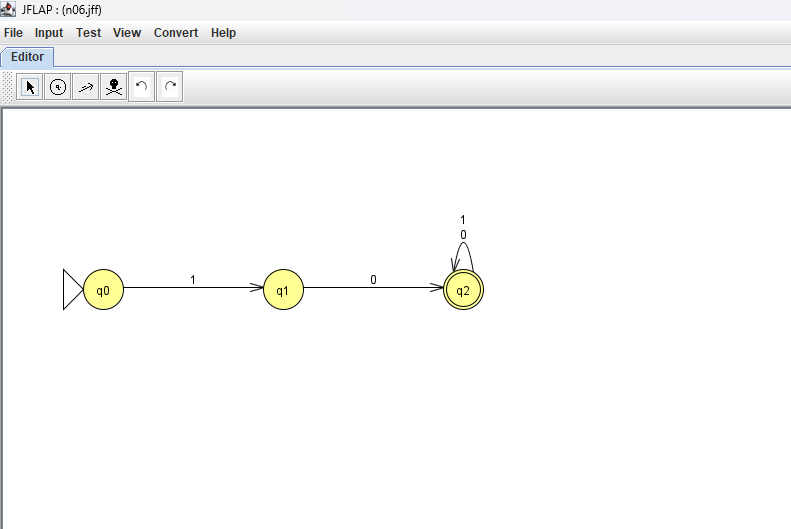
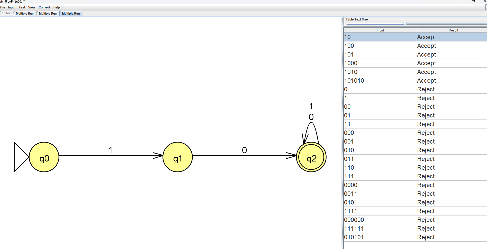
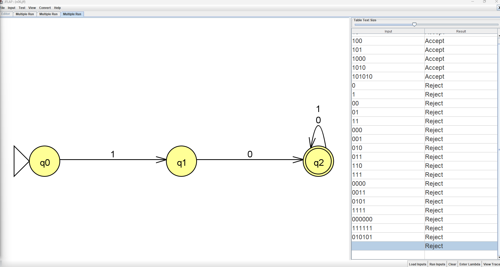
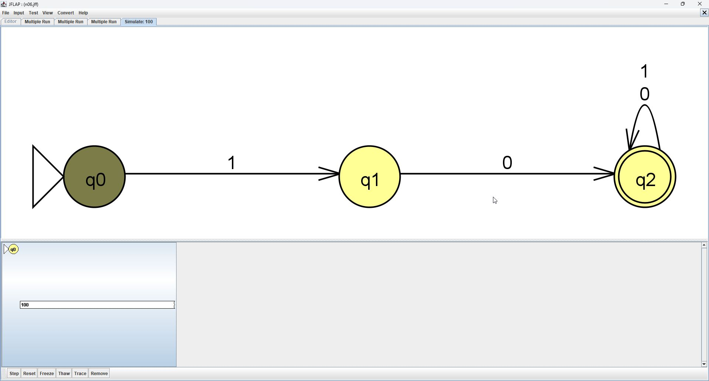
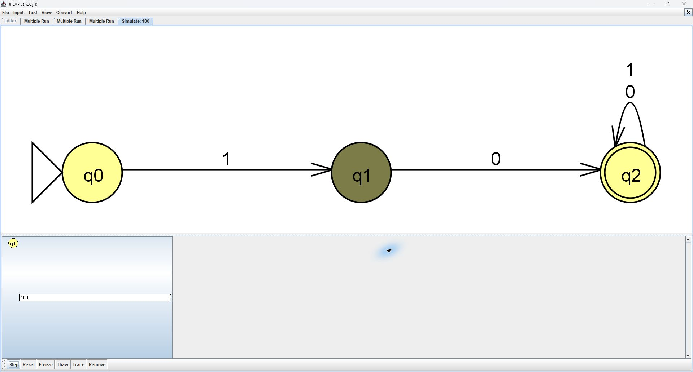
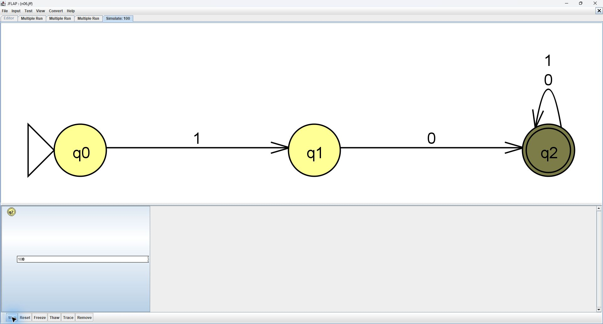
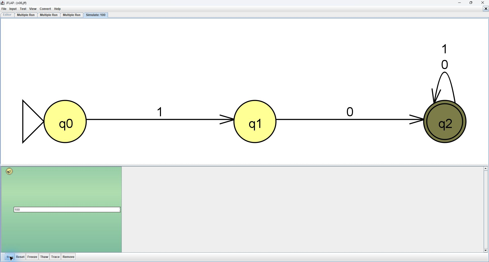

# Problem 6: Starts with 10

Alphabet: {0,1}. Initial state: q0. Final state: q2

## Machine

| From | Symbol | To |
|---|---|---|
| q0 | 1 | q1 |
| q1 | 0 | q2 |
| q2 | 0 | q2 |
| q2 | 1 | q2 |

## Tests

Load n06t.txt with Input > Multiple Run > Load Inputs, then click Run Inputs. Accepted strings precede rejected strings.

Test the empty string separately with Enter Lambda. Expected: **Reject**. Blank lines are not reliable empty-string inputs in whitespace-delimited files.

| String | Expected |
|---|---|
| `10` | Accept |
| `100` | Accept |
| `101` | Accept |
| `1000` | Accept |
| `1010` | Accept |
| `101010` | Accept |
| `0` | Reject |
| `1` | Reject |
| `00` | Reject |
| `01` | Reject |
| `11` | Reject |
| `000` | Reject |
| `001` | Reject |
| `010` | Reject |
| `011` | Reject |
| `110` | Reject |
| `111` | Reject |
| `0000` | Reject |
| `0011` | Reject |
| `0101` | Reject |
| `1111` | Reject |
| `000000` | Reject |
| `111111` | Reject |
| `010101` | Reject |

## JFLAP batch screenshot

All 24 nonempty test strings matched the expected results in the supplied JFLAP screenshot. The empty string was also tested in JFLAP and correctly rejected: it does not start with `10`.

## Computation trace

Traced string: `100`. This is a boundary example. Its JFLAP trace matched the prediction; no design mistake was observed.

| Step | Prefix read | Active states |
|---|---|---|
| 0 | empty | q0 |
| 1 | 1 | q1 |
| 2 | 10 | q2 |
| 3 | 100 | q2 |

### JFLAP step screenshots

Initial configuration: q0, no input consumed.

After reading `1`: q1.

After reading `10`: q2, with one bit still unread.

After reading `100`: q2 with no input remaining. The green configuration indicates acceptance.

### Handwritten computation tree

The upper-left tree in this scan shows (q0, 100) --1--> (q1, 00) --0--> (q2, 0) --0--> (q2, empty), which accepts.

