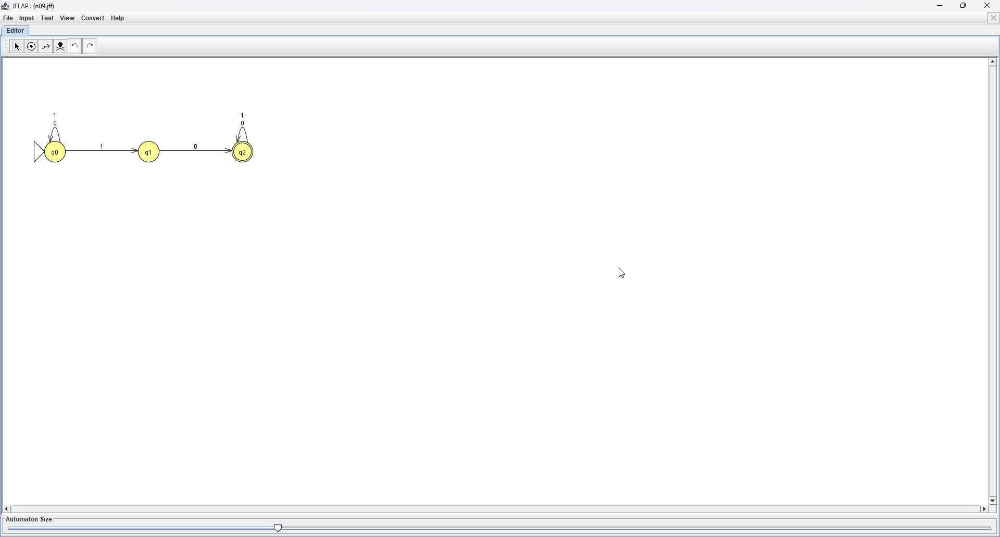
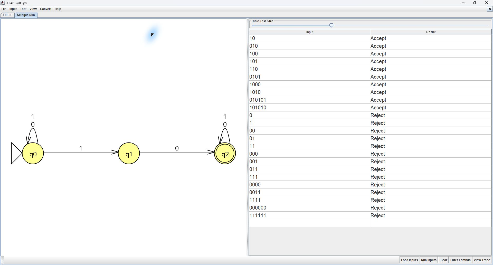
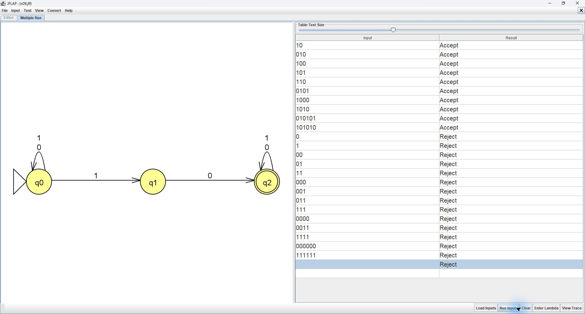
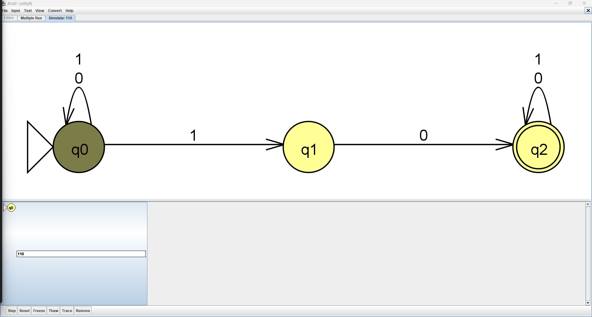
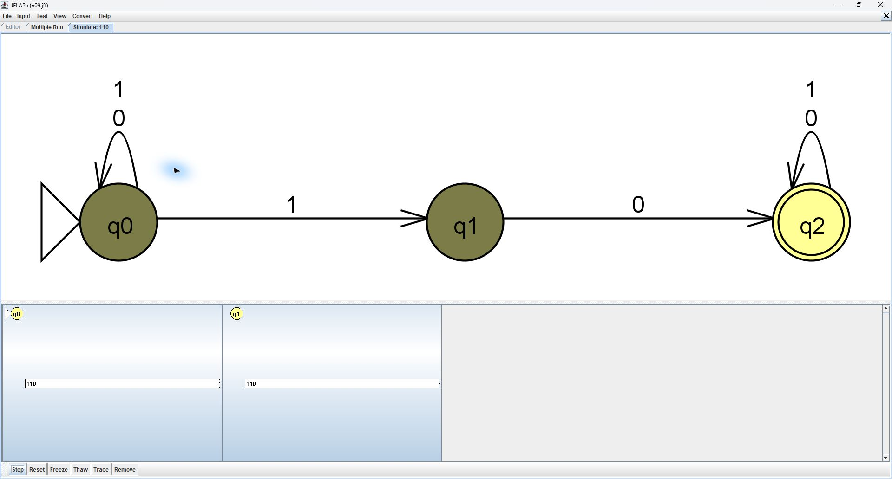
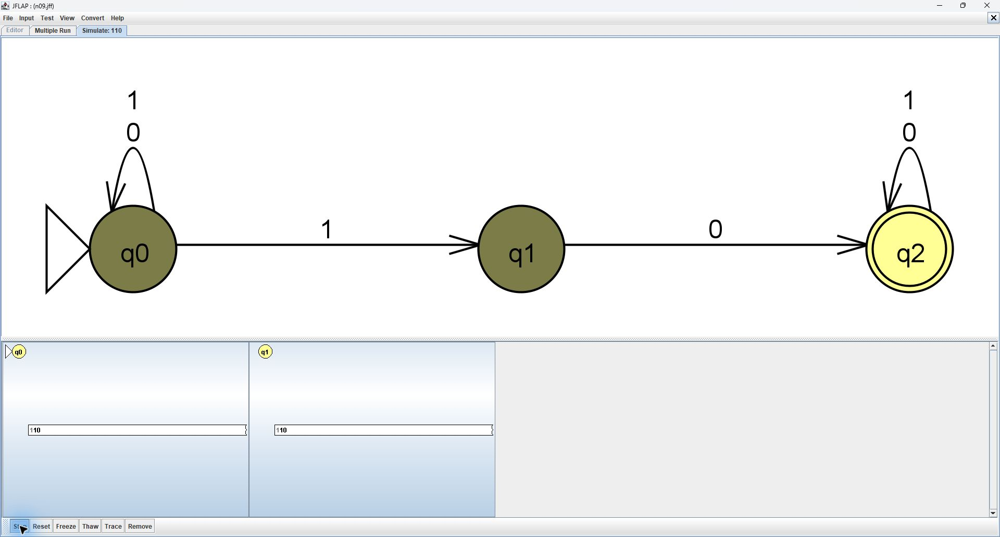
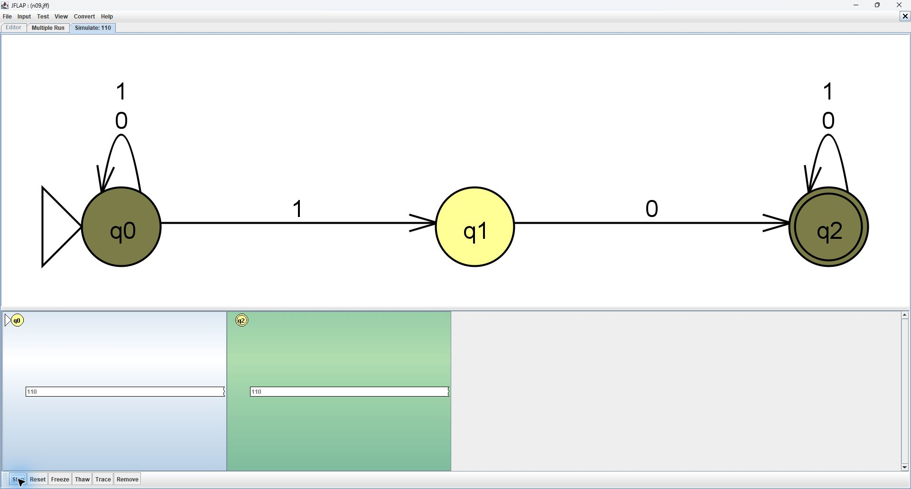
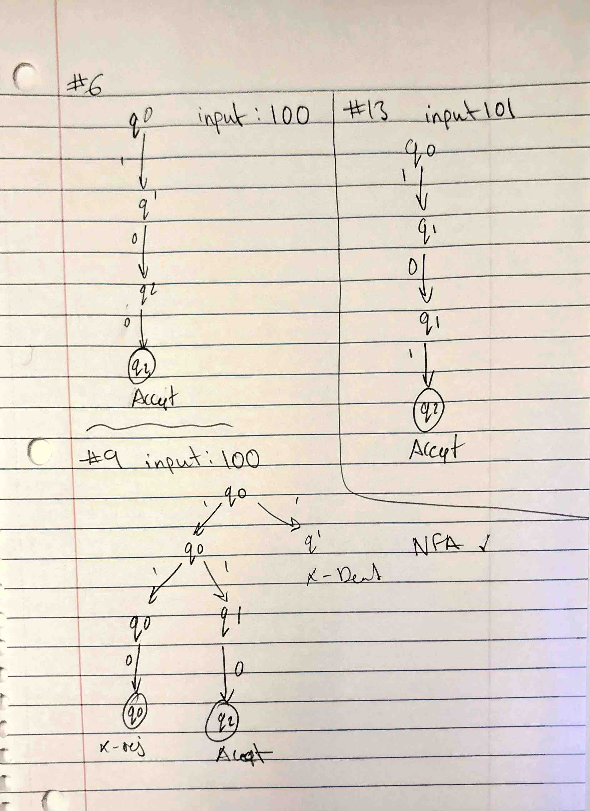

# Problem 9: Contains substring 10

Alphabet: {0,1}. Initial state: q0. Final state: q2

## Machine

| From | Symbol | To |
|---|---|---|
| q0 | 0 | q0 |
| q0 | 1 | q0 |
| q0 | 1 | q1 |
| q1 | 0 | q2 |
| q2 | 0 | q2 |
| q2 | 1 | q2 |

## Tests

Load n09t.txt with Input > Multiple Run > Load Inputs, then click Run Inputs. Accepted strings precede rejected strings.

Test the empty string separately with Enter Lambda. Expected: **Reject**. Blank lines are not reliable empty-string inputs in whitespace-delimited files.

| String | Expected |
|---|---|
| `10` | Accept |
| `010` | Accept |
| `100` | Accept |
| `101` | Accept |
| `110` | Accept |
| `0101` | Accept |
| `1000` | Accept |
| `1010` | Accept |
| `010101` | Accept |
| `101010` | Accept |
| `0` | Reject |
| `1` | Reject |
| `00` | Reject |
| `01` | Reject |
| `11` | Reject |
| `000` | Reject |
| `001` | Reject |
| `011` | Reject |
| `111` | Reject |
| `0000` | Reject |
| `0011` | Reject |
| `1111` | Reject |
| `000000` | Reject |
| `111111` | Reject |

## JFLAP batch screenshot

All 24 nonempty inputs matched their expected results in JFLAP. The empty string was tested separately and correctly rejected.

## Computation trace

Traced string: `110`. JFLAP matched the predicted state sets. No design mistake was observed.

| Step | Prefix read | Active states |
|---|---|---|
| 0 | empty | q0 |
| 1 | 1 | q0, q1 |
| 2 | 11 | q0, q1 |
| 3 | 110 | q0, q2 |

### JFLAP step screenshots

### Handwritten computation tree - heading correction pending

The lower tree in this scan correctly follows `110`, including the q1 branch that dies on the second `1`. Its heading mistakenly says `100`; correct that heading by hand to `110` and replace the scan before submitting.

For #9 on `110`, q0 and q1 are both active after the first 1. On the second 1, the old q1 branch dies and q0 creates a fresh q1 branch. That branch reads 0 to reach q2.

