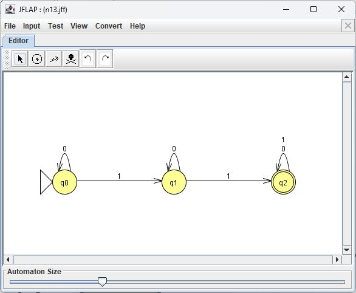
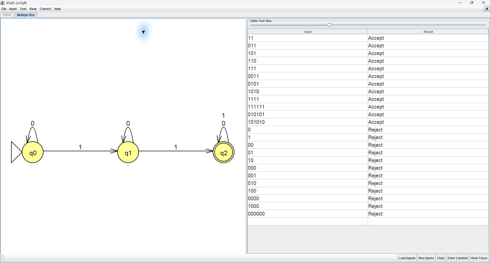
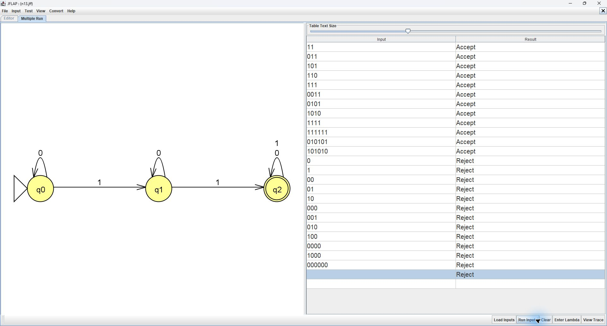
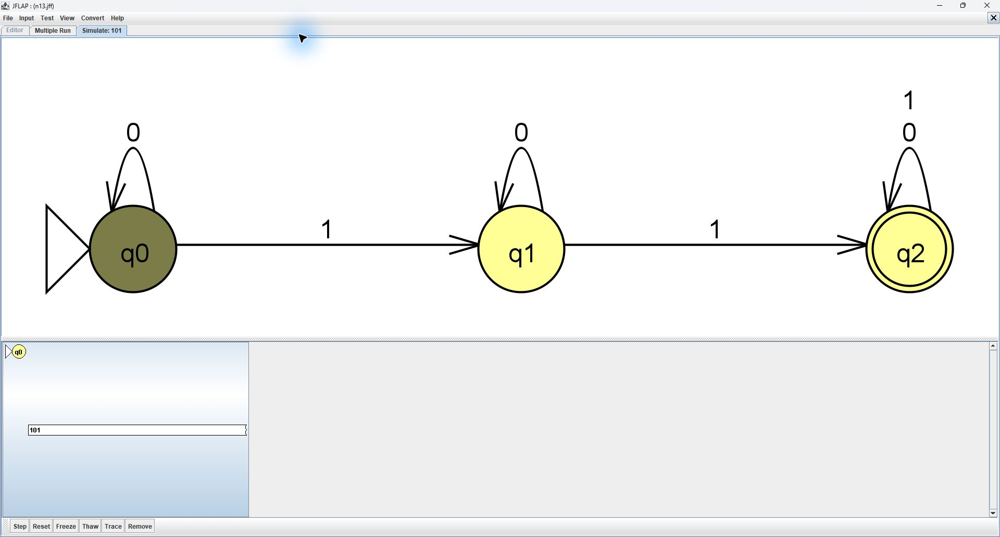
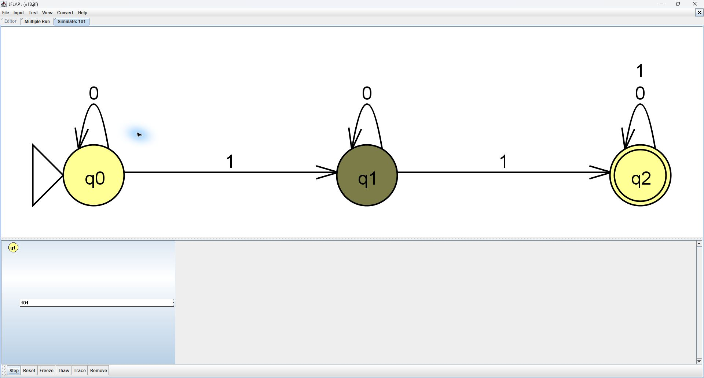
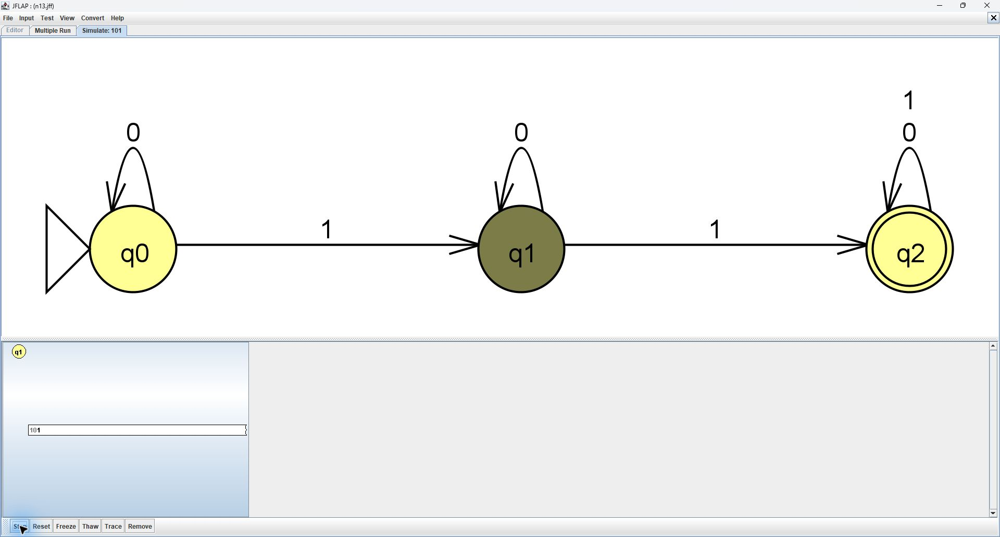
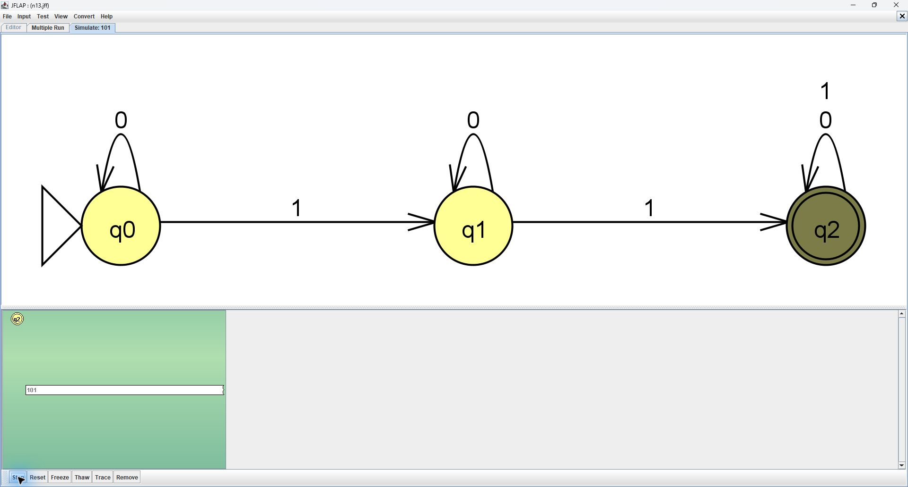

# Problem 13: At least two 1s

Alphabet: {0,1}. Initial state: q0. Final state: q2

## Machine

| From | Symbol | To |
|---|---|---|
| q0 | 0 | q0 |
| q0 | 1 | q1 |
| q1 | 0 | q1 |
| q1 | 1 | q2 |
| q2 | 0 | q2 |
| q2 | 1 | q2 |

## Tests

Load n13t.txt with Input > Multiple Run > Load Inputs, then click Run Inputs. Accepted strings precede rejected strings.

Test the empty string separately with Enter Lambda. Expected: **Reject**. Blank lines are not reliable empty-string inputs in whitespace-delimited files.

| String | Expected |
|---|---|
| `11` | Accept |
| `011` | Accept |
| `101` | Accept |
| `110` | Accept |
| `111` | Accept |
| `0011` | Accept |
| `0101` | Accept |
| `1010` | Accept |
| `1111` | Accept |
| `111111` | Accept |
| `010101` | Accept |
| `101010` | Accept |
| `0` | Reject |
| `1` | Reject |
| `00` | Reject |
| `01` | Reject |
| `10` | Reject |
| `000` | Reject |
| `001` | Reject |
| `010` | Reject |
| `100` | Reject |
| `0000` | Reject |
| `1000` | Reject |
| `000000` | Reject |

## JFLAP batch screenshot

All 24 nonempty test inputs matched their expected results in JFLAP. The empty string also correctly rejected because it contains no 1s.

## Computation trace

Traced string: `101`. JFLAP matched the prediction; no design mistake was observed.

| Step | Prefix read | Active states |
|---|---|---|
| 0 | empty | q0 |
| 1 | 1 | q1 |
| 2 | 10 | q1 |
| 3 | 101 | q2 |

### JFLAP step screenshots

### Handwritten computation tree

The upper-right tree in this scan shows (q0, 101) --1--> (q1, 01) --0--> (q1, 1) --1--> (q2, empty), which accepts.

