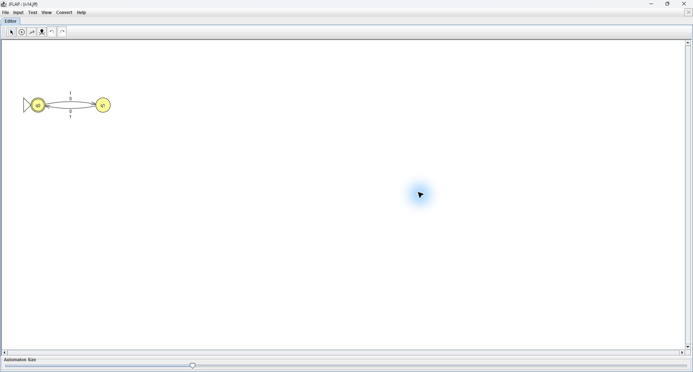
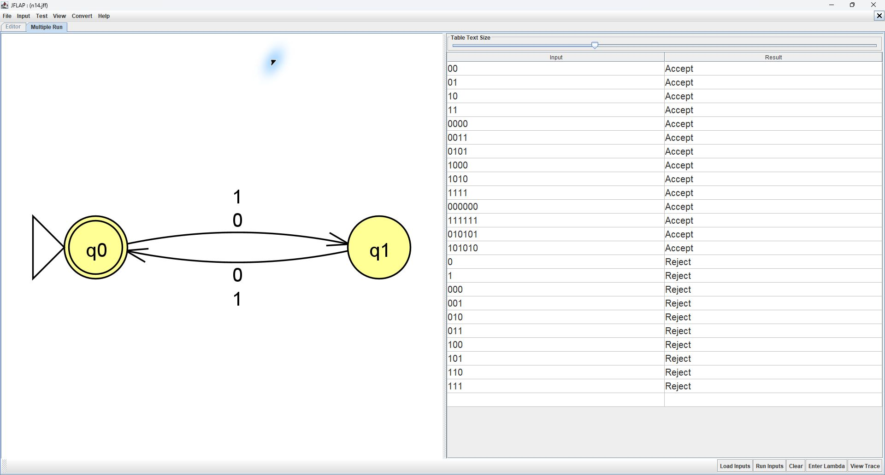
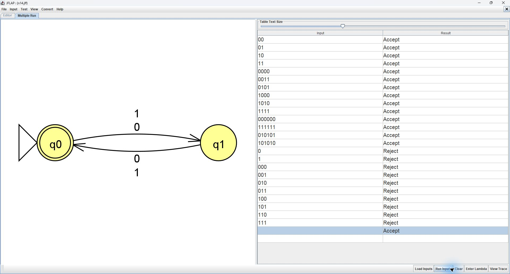

# Problem 14: Even length

Alphabet: {0,1}. Initial state: q0. Final state: q0

## Machine

| From | Symbol | To |
|---|---|---|
| q0 | 0 | q1 |
| q0 | 1 | q1 |
| q1 | 0 | q0 |
| q1 | 1 | q0 |

## Tests

Load n14t.txt with Input > Multiple Run > Load Inputs, then click Run Inputs. Accepted strings precede rejected strings.

Test the empty string separately with Enter Lambda. Expected: **Accept**. Blank lines are not reliable empty-string inputs in whitespace-delimited files.

| String | Expected |
|---|---|
| `00` | Accept |
| `01` | Accept |
| `10` | Accept |
| `11` | Accept |
| `0000` | Accept |
| `0011` | Accept |
| `0101` | Accept |
| `1000` | Accept |
| `1010` | Accept |
| `1111` | Accept |
| `000000` | Accept |
| `111111` | Accept |
| `010101` | Accept |
| `101010` | Accept |
| `0` | Reject |
| `1` | Reject |
| `000` | Reject |
| `001` | Reject |
| `010` | Reject |
| `011` | Reject |
| `100` | Reject |
| `101` | Reject |
| `110` | Reject |
| `111` | Reject |

## JFLAP batch screenshot

All 24 nonempty inputs matched their expected results in JFLAP. The empty string correctly accepted because zero is an even length.

